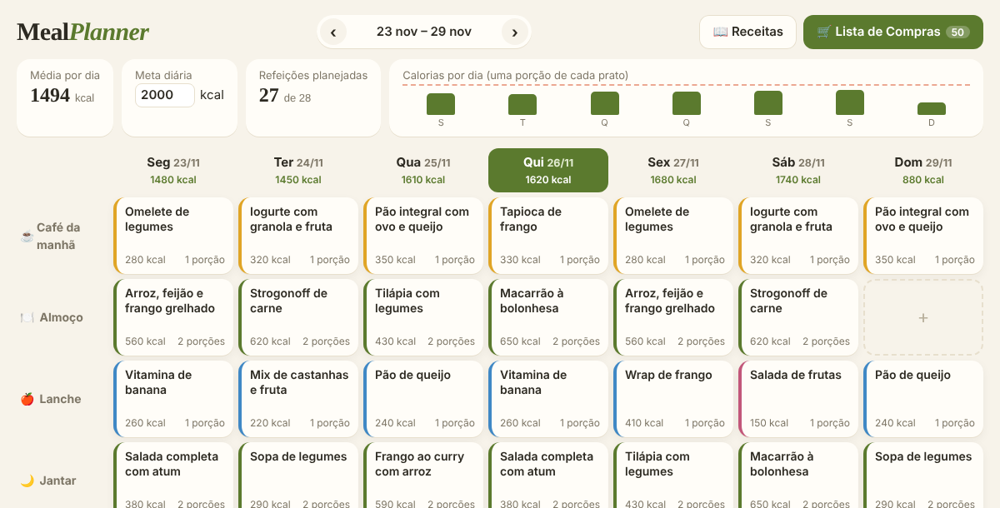

# MealPlanner — Cardápio da semana

Planeje as refeições da semana por dia e horário, veja a estimativa de calorias e gere a lista de compras automaticamente.

🔗 **[Ver o site no ar](https://iamviniciuslima05.github.io/PROJETO-MealPlanner/)**



## Funcionalidades

- Grade da semana com **café, almoço, lanche e jantar**
- **Receitas** com calorias por porção e ingredientes
- Quantidade de **porções** em cada refeição
- **Calorias por dia** e média da semana, com meta diária
- **Lista de compras** gerada somando os ingredientes, separada por seção do mercado
- Marcar itens comprados e **copiar a lista**
- **Arrastar e soltar** pratos entre os dias
- Navegação entre semanas

## Tecnologias

HTML5 · CSS3 · JavaScript · Drag and Drop API · localStorage

## Estrutura

```
index.html
css/style.css
js/script.js
```

## Como rodar

Não precisa instalar nada: baixe o projeto e abra o `index.html` no navegador, ou acesse a versão publicada acima.

---
Feito por **Vinicius Lima** · [Portfólio](https://viniciuslimadev.netlify.app) · [LinkedIn](https://www.linkedin.com/in/viniciuslima25/)
